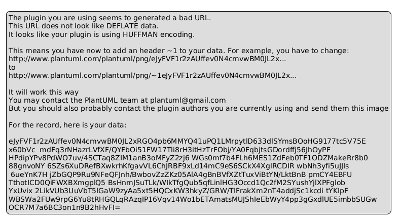

# Develop02: Journal Program - Design Submission

## CSE 210: Programming with Classes - Abstraction Activity

---

## 1. Class Diagram



---

## 2. Class Details

### Class: Journal

**Purpose:** Manages a collection of journal entries and provides operations to add, display, save, and load entries from files.

#### Attributes:
| Attribute | Type | Description |
|-----------|------|-------------|
| `_entries` | `List<Entry>` | Collection of all Entry objects in the journal |

#### Behaviors/Methods:
| Method | Parameters | Return Type | Description |
|--------|-----------|------------|-------------|
| `Journal()` | None | Constructor | Initializes an empty list of entries |
| `AddEntry()` | `entry: Entry` | `void` | Adds a new entry to the journal |
| `DisplayAll()` | None | `void` | Displays all entries in the journal; shows message if empty |
| `SaveToFile()` | `filename: string` | `void` | Saves all entries to a CSV file; handles file I/O errors |
| `LoadFromFile()` | `filename: string` | `void` | Loads entries from a CSV file; clears existing entries; supports legacy format |
| `DisplayStatistics()` | None | `void` | Shows total entries, total/average words, and average mood rating |
| `CountWords()` | `text: string` | `int` | Private helper; counts words in a string |

---

### Class: Entry

**Purpose:** Represents a single journal entry with a prompt, response, date, and mood rating. Handles display and file serialization.

#### Attributes:
| Attribute | Type | Description |
|-----------|------|-------------|
| `_prompt` | `string` | The reflection prompt for this entry |
| `_response` | `string` | The user's written response to the prompt |
| `_date` | `string` | The date the entry was created (short date format) |
| `_moodRating` | `int` | Mood rating from 1-5; 0 means not recorded |

#### Behaviors/Methods:
| Method | Parameters | Return Type | Description |
|--------|-----------|------------|-------------|
| `Entry()` | `prompt: string, response: string, moodRating: int` | Constructor | Creates a new entry with current date and given prompt/response/mood |
| `GetPrompt()` | None | `string` | Returns the prompt text |
| `GetResponse()` | None | `string` | Returns the response text |
| `GetDate()` | None | `string` | Returns the entry date |
| `GetMoodRating()` | None | `int` | Returns the mood rating (1-5 or 0) |
| `Display()` | None | `void` | Displays the entry in formatted text to the console |
| `ToFileFormat()` | None | `string` | Returns the entry as a CSV line with proper quoting |
| `FromFileFormat()` | `line: string` | `Entry` (static) | Parses a CSV or legacy line and returns an Entry object |
| `EscapeCsvField()` | `field: string` | `string` (private) | Escapes commas and quotes in CSV fields |
| `ParseCsvRecord()` | `record: string` | `List<string>` (private) | Parses a CSV record handling quoted fields |

---

### Class: PromptGenerator

**Purpose:** Provides a collection of reflection prompts and returns them randomly.

#### Attributes:
| Attribute | Type | Description |
|-----------|------|-------------|
| `_prompts` | `List<string>` | Collection of reflection prompt strings |
| `_random` | `Random` | Random number generator for selecting prompts |

#### Behaviors/Methods:
| Method | Parameters | Return Type | Description |
|--------|-----------|------------|-------------|
| `PromptGenerator()` | None | Constructor | Initializes the prompt list with 8 reflection prompts |
| `GetRandomPrompt()` | None | `string` | Returns a randomly selected prompt from the collection |

---

### Class: Program

**Purpose:** Entry point for the application. Implements the menu-driven user interface.

#### Attributes:
None (static methods only)

#### Behaviors/Methods:
| Method | Parameters | Return Type | Description |
|--------|-----------|------------|-------------|
| `Main()` | `args: string[]` | `void` (static) | Main program loop; displays menu and delegates to helper methods |
| `WriteNewEntry()` | `journal: Journal, promptGenerator: PromptGenerator` | `void` (static) | Gets a prompt, accepts user response, reads mood, and adds entry to journal |
| `TryReadMoodRating()` | `out moodRating: int` | `bool` (static) | Validates and returns a mood rating from 1-5; returns false on EOF |
| `SaveJournal()` | `journal: Journal` | `void` (static) | Prompts for filename and calls journal.SaveToFile() |
| `LoadJournal()` | `journal: Journal` | `void` (static) | Prompts for filename and calls journal.LoadFromFile() |

---

## 3. Program Interaction Flow

```
┌────────────────────────────────────────────────────────────────┐
│                     MAIN PROGRAM FLOW                          │
└────────────────────────────────────────────────────────────────┘

INITIALIZATION
├─ Create Journal object (empty _entries list)
├─ Create PromptGenerator object (loads 8 prompts)
└─ Set running = true

MAIN LOOP (while running)
├─ Display menu with 6 options
├─ Read user choice (1-6)
└─ Dispatch based on choice:
   │
   ├─ [1] Write new entry
   │  ├─ Call PromptGenerator.GetRandomPrompt()
   │  ├─ Display prompt to user
   │  ├─ Read user's response
   │  ├─ Call TryReadMoodRating() to get 1-5 rating
   │  ├─ Create Entry object with (prompt, response, mood)
   │  │  └─ Entry constructor sets _date = DateTime.Now
   │  ├─ Call Journal.AddEntry(entry)
   │  │  └─ Adds to _entries list
   │  └─ Show "Entry saved!"
   │
   ├─ [2] Display journal
   │  ├─ Call Journal.DisplayAll()
   │  ├─ For each Entry in _entries:
   │  │  └─ Call Entry.Display()
   │  │     ├─ Prints date, prompt, response, mood rating
   │  │     └─ Separates entries with blank lines
   │  └─ Show message if journal is empty
   │
   ├─ [3] Save journal to file
   │  ├─ Prompt user for filename
   │  ├─ Call Journal.SaveToFile(filename)
   │  ├─ For each Entry, call Entry.ToFileFormat()
   │  │  └─ Returns CSV line with escaped fields
   │  ├─ Write all lines to file
   │  └─ Show success or error message
   │
   ├─ [4] Load journal from file
   │  ├─ Prompt user for filename
   │  ├─ Call Journal.LoadFromFile(filename)
   │  ├─ For each line in file:
   │  │  ├─ Call Entry.FromFileFormat(line)
   │  │  │  ├─ Detects if legacy (~|~) or CSV format
   │  │  │  └─ Returns Entry object
   │  │  └─ Add to new list
   │  ├─ Clear _entries and replace with loaded entries
   │  └─ Show success or error message
   │
   ├─ [5] View journal statistics
   │  ├─ Call Journal.DisplayStatistics()
   │  ├─ Show entry count
   │  ├─ Show total and average word counts (via CountWords helper)
   │  ├─ Show average mood rating (for entries with mood > 0)
   │  └─ Show message if no entries exist
   │
   └─ [6] Quit
      └─ Set running = false and exit loop

PROGRAM END
└─ Print "Goodbye!" and terminate
```

---

## 4. Key Design Decisions

### Separation of Concerns
- **Journal**: Manages collection and file I/O
- **Entry**: Encapsulates individual entry data and formatting
- **PromptGenerator**: Abstracts prompt retrieval
- **Program**: Orchestrates user interaction and delegates to classes

### Encapsulation
- All attributes are private (`_fieldName`), accessed only through public methods
- Entry class handles its own serialization (CSV), so Journal doesn't need to know formatting details
- PromptGenerator abstraction allows future changes (e.g., load from file) without affecting Program

### File Format
- Uses CSV with proper quote escaping to handle commas and quotes in responses
- Maintains backward compatibility by detecting and loading legacy `~|~` format
- Entries without mood ratings still load correctly (mood = 0)

### Error Handling
- File I/O catches IOException, UnauthorizedAccessException, ArgumentException, NotSupportedException
- CSV parsing detects malformed records and throws FormatException
- User input validates mood ratings (1-5 only)

---

## 5. Exceeding Requirements

✓ **Mood Rating Feature**: Each entry includes a 1-5 mood rating for deeper reflection tracking  
✓ **Journal Statistics**: Displays word counts and mood trends across entries  
✓ **CSV Format**: Preserves special characters and works with spreadsheet software  
✓ **Backward Compatibility**: Loads older entries without mood ratings  
✓ **Data Integrity**: Proper file error handling and input validation  

---
